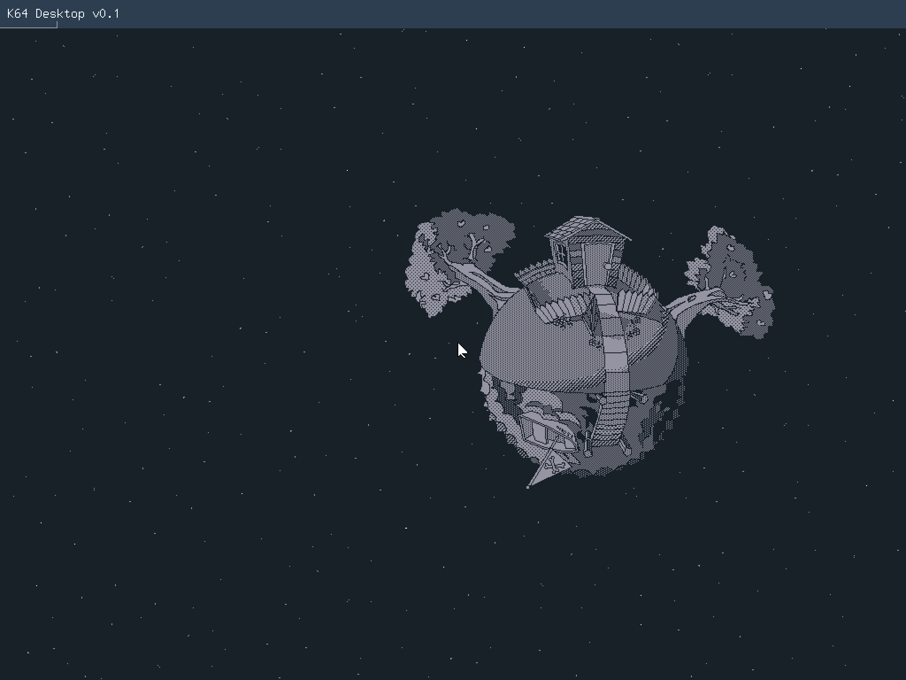

# KolibriOS 64

An x86-64 port of KolibriOS, built with fasm2.



## Run on macOS

Install Python 3 and QEMU, and place the project's fasm2 checkout beside
this repository or set `FASM2_DIR`. The launcher builds and boots the desktop.

```sh
python3 tools/run-qemu-debug.py --desktop
```

## Desktop features

- **CHIP-8** runs Tetris. Press Enter to start, use the arrow keys to play, and press Esc to close.
- **Files** browses a read-only FAT16 disk and previews files in hex and ASCII.
- Both apps run together through cooperative multitasking. Drag windows by their title bars and switch between them from the taskbar.
- Drag the QEMU window edge to change the guest resolution. The desktop keeps its 4:3 aspect ratio.

[Porting notes and verification](docs/PORTING-32TO64.md)
